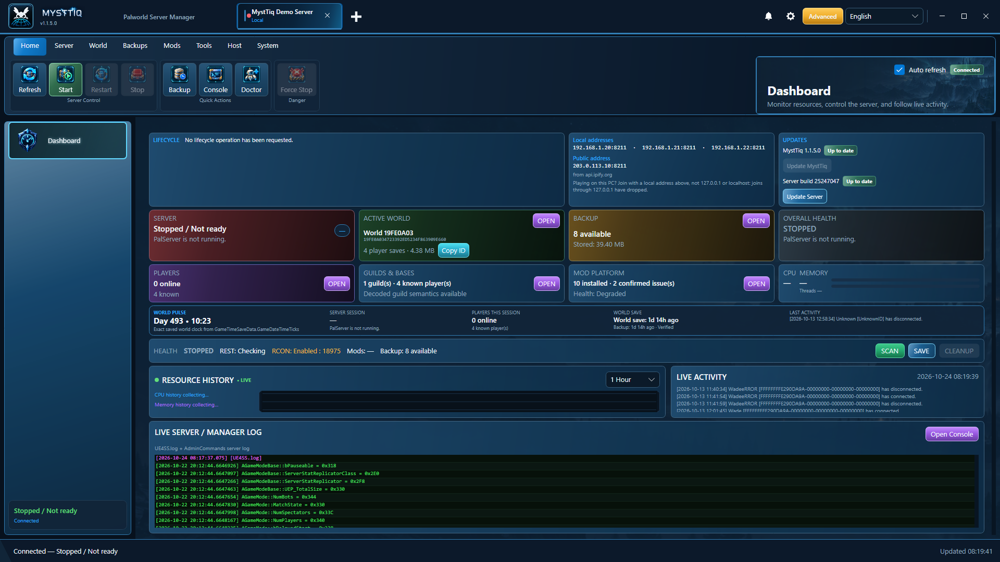
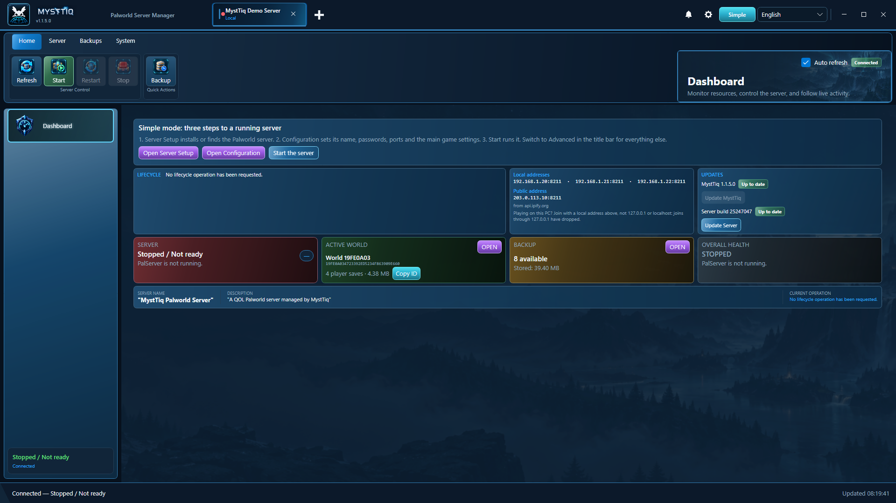
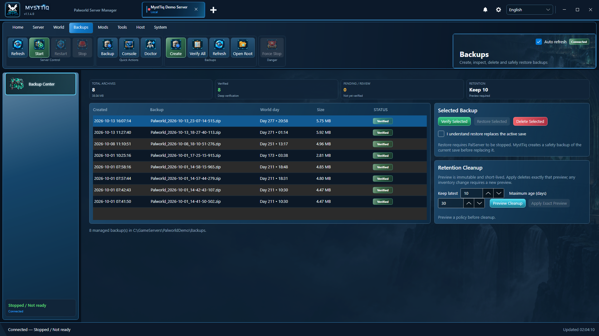
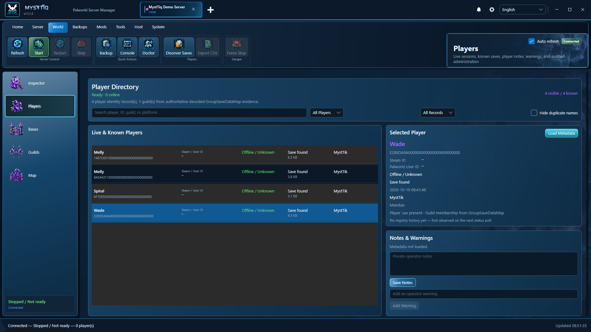
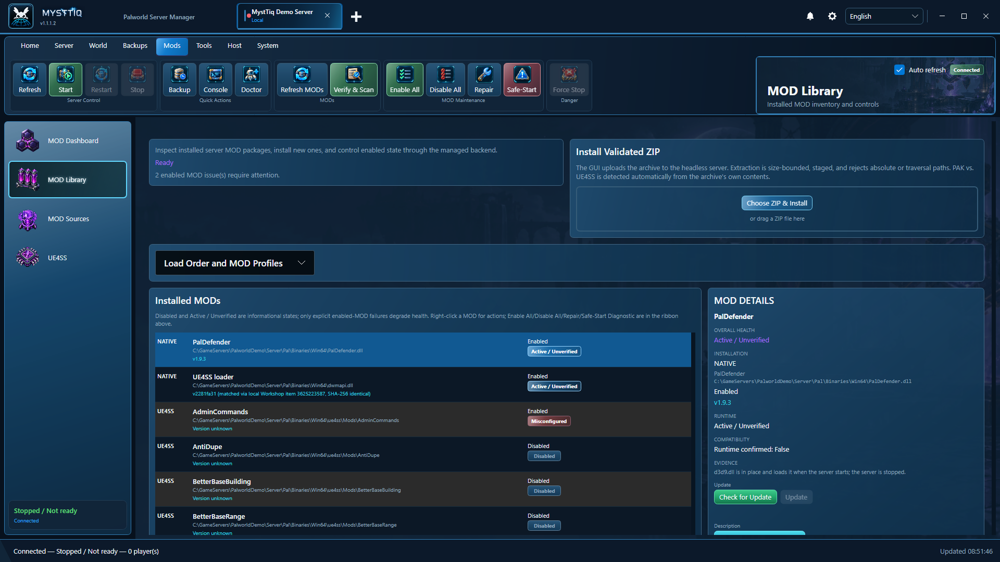

<!-- MystTiq v1.1.5.0: file reviewed for this release (2026-10-25). -->
<p align="center">
  
</p>

<h1 align="center">Your worlds. Your servers. One place to manage them.</h1>

<p align="center">An open-source desktop for running Palworld communities.<br>Manage servers, protect worlds, organize mods, and share administration across your team.</p>

<p align="center">
  <a href="LICENSE"></a>
  
  
  
</p>

<p align="center">
  <a href="https://github.com/Wad3M/MystTiq-Palworld-Server-Manager/releases"><strong>Browse downloads</strong></a> ·
  <a href="#get-started">Get started</a> ·
  <a href="docs/roadmap/PRODUCT_ROADMAP.md">Roadmap</a> ·
  <a href="https://github.com/Wad3M/MystTiq-Palworld-Server-Manager/issues/new/choose">Get help / contribute</a>
</p>

**Current release: v1.1.5.0 · Accepted baseline: v1.1.0.0**

MystTiq 1.1 is the new accepted baseline: everything since 1.0, checked as one release. v1.1.0.1 fixes an error notice at start-up, and v1.1.0.2 gives players sent to a new character their own back: MystTiq checks every join and moves the character to the player ID the game now gives the account; v1.1.0.3 makes a move leave nothing behind; v1.1.1.0 adds MOD Sources, runs the player checks without the desktop and adds the Linux and Docker downloads; v1.1.1.1 leaves .NET's unused crash-dump helper out of the downloads; v1.1.1.2 keeps the Players, Guilds and Map pages current; v1.1.1.3 updates four libraries; v1.1.2.0 records why a server stopped and can start MystTiq with Windows; v1.1.4.0 updates the server from the Dashboard; v1.1.5.0 adds a Windows setup, a portable version, a window you can size and a Simple mode ([release notes](release-notes/v1.1.5.0.md)). Downloads are on the Releases page: a Windows setup, a portable Windows version, ZIPs for Windows and Linux, and a Docker image of the service.

<a id="whats-new-in-v1.1.0.0"></a>

## ✨ Highlights since v1.1.0.0

Everything added since 1.0, in one place. Each version's own notes are in [release-notes](release-notes/) and the [changelog](CHANGELOG.md).

**Your players and your world**
- **Characters protected on join.** Each Steam player's character is checked as they join, and one the game moved to a new player ID is moved to it automatically (v1.1.0.2); a player handed a different character is turned away before a new one is made, and a player still loading is given time. Player names are unique to one account.
- **Guarded save edits.** Remove or add an item in a player's saved inventory, or add or remove a Pal in their Pal box. Each edit is previewed and confirmed, runs only while the server is stopped, takes a checked safety backup first, and is verified before it replaces the world.
- **Bases and Guilds** each have their own page: places with locations and workers, and people with a roster.
- **Level-gap scans.** A new anti-cheat rule reports a player who gains far more levels than their time on your server allows, with the numbers. It only reports, and it accounts for your experience rate.

**Your MODs**
- **A MOD browser.** Search your Downloads folder, Thunderstore, CurseForge, GitHub releases or Nexus Mods and install a MOD's file in one step; each archive is checked before anything is written. Since v1.1.1.0 it is on **MODs > MOD Sources** with Steam Workshop and the Nexus Mods catalog.
- **Load order and profiles.** Set the order UE4SS loads your MODs in, and export your MOD setup to a file you can import on this or another server. The import shows what will change first, and the file never contains the MOD files.
- **PalDefender and the UE4SS loader** show on the MODs page with their version and an on/off switch.

**Running unattended**
- **A frozen server is restarted**, with an alert; a healthy one is never touched.
- **Why it stopped.** Every stop records who or what asked for it (a button, Exit from the tray, Discord, an automation rule, a character move), and the Dashboard shows the last one (v1.1.2.0).
- **Starts with Windows** if you choose: MystTiq opens in the tray when you sign in and starts again the server that was running, never one you stopped (v1.1.2.0).
- **Proof that alerts arrive.** Every Discord, email and webhook send is recorded with its result, and the Dashboard warns when a channel has stopped delivering. A burst of alerts is queued and repeats are combined.
- **One thing at a time.** Backups, updates and MOD changes can no longer overlap a server start or a save edit; scheduled work waits its turn.
- **Nothing lost when a file is damaged.** If one of MystTiq's own lists can't be read, it loads the last good copy or refuses changes, and alerts you with a link to the repair.
- **Tested under load and over time**: simultaneous operations, 10,000 console lines, and 24-hour idle runs on Windows and Linux.

**Everyday administration**
- **Install it your way on Windows**: a setup with shortcuts and an uninstaller, or a portable copy that keeps everything in its own folder (v1.1.5.0).
- **Simple or Advanced**: one switch in the title bar keeps just what you need to set up, configure and start a server, and the window can be sized from any edge and remembers where it was (v1.1.5.0).
- **Update from the Dashboard.** A card shows your server build against Steam's and MystTiq's version against the latest release, each with its own Update button; the server update stops it, takes a safety backup, updates it and starts it again (v1.1.4.0; MystTiq added in v1.1.5.0). The players' addresses sit beside it.
- **Settings without starting the server.** Configuration reads your server's settings file as soon as it opens (v1.1.5.0).
- **Update, on every row** of the Update Center, including MystTiq's own update, checked against its published checksums.
- **Discord commands that answer.** The bot's start, stop, restart and backup commands now show their result instead of "did not respond".
- **Progress you can see.** A server start shows its steps, backup scans show "12 of 47" and can be cancelled, and the connection line says what is wrong.
- **Server > Launcher**, a clean **Exit** from the tray, the server's addresses on the Dashboard, and help when a start gets stuck.
- **Secrets stay secret.** Saved passwords, webhook URLs and the bot token are encrypted on disk, and kept out of logs and exports.
- **A read-only browser view** at `/web`, and a **Docker image** of the headless service.
- **Buttons coloured by what they do**, the same on every page.

[Release notes](release-notes/v1.1.0.0.md) · [Translation inventory](docs/i18n/UI_TEXT_INVENTORY.md) · [Help review a translation](CONTRIBUTING.md#translation-feedback)

<a id="see-your-server-at-a-glance"></a>

## 📸 See your server at a glance



*Dashboard in v1.1.5.0. The screenshots featured here are included in the v1.1.5.0 FullSource archive and show the demo server; its status and data are illustrative, and its addresses are documentation examples.*

<a id="built-around-everyday-administration"></a>

## 🧰 Built around everyday administration

| Work you need to do | Tools in MystTiq |
| --- | --- |
| **Run your servers** | Setup and adoption, start/stop/restart with visible steps, updates, configuration, the Launcher, scheduling, diagnostics, crash recovery and a frozen-server watchdog |
| **Protect your worlds** | Backups with in-game days, retention and restore checks, guarded save edits (items and Pals), and guarded world/player/guild repair and migration workflows |
| **Look after your community** | Player tools, protected characters and unique names, world map, kits, item/Pal tools, teleport points, whitelist, temporary bans, anti-cheat rules and Discord commands; some actions require a supported mod/provider |
| **Keep mods organized** | A MOD browser, inventory, enable/disable, UE4SS load order, MOD profiles, health checks, rollback, UE4SS/Workshop/PalDefender support and Nexus integration |
| **Understand the host** | CPU, memory, disk and network information, seven-day history, priority, eco mode, processor cores and game-level bandwidth settings |
| **Share administration** | Named accounts, Viewer/Operator/Admin/Owner roles, scoped permissions, audit records, a read-only browser view and remote connections with pinned TLS; disabled controls name the role they need |
| **Make it comfortable** | Dark, Light, Midnight, High contrast and Follow system modes, density settings, themed artwork and 12 language options |

Nexus download options depend on the account and provider. Game-level bandwidth settings are not OS-level traffic shaping.

<details>
<summary><strong>More of the interface: Simple mode, backups, players and mods</strong></summary>

### 🧭 Simple mode

One switch in the title bar keeps just what you need to set up, configure and start a server, with a three-step guide.



### 💾 Backups

Browse verified backups by in-game day and preview retention cleanup.



### 👥 Players

Find known players and inspect their saved characters, guild membership and operator notes.



### 🧩 MOD Library

Inspect installed MODs, manage enabled state, and access load order and MOD profiles.



</details>

<a id="get-started"></a>

## 🚀 Get started

1. Open [Releases](https://github.com/Wad3M/MystTiq-Palworld-Server-Manager/releases) and read the selected version's notes.
2. On Windows, run its **Windows-x64.msi** (installs to Program Files with shortcuts), or extract **Windows-x64-Portable.zip** anywhere (everything stays in its folder), or extract **Windows-x64.zip** and run **MystTiq.Desktop.exe** (keep the `headless` folder alongside it). Every package includes .NET.
3. Configure a local service or connect to a remote MystTiq service. Keep existing server data and backups separate from the application folder.

| Download | Who it's for |
| --- | --- |
| `Windows-x64.msi` | Windows: the setup (Program Files, Start-menu shortcut, uninstaller; not code-signed yet, so SmartScreen asks first) |
| `Windows-x64-Portable.zip` | Windows: a portable copy that keeps everything in its `data` folder and writes nothing to Windows |
| `Windows-x64.zip` | Windows users who want to run the app from a folder |
| `Linux-x64.zip` | Linux x64: the desktop and the service (after extracting, `chmod +x MystTiq.Desktop headless/mysttiq-server`) |
| `Docker-linux-x64.tar.gz` | The headless service as a Docker image: `docker load -i` the file, then run `mysttiq-headless:<version>` with a `/data` volume |
| `FullSource.zip` / GitHub source archives | Developers who want to build or inspect the source |
| `SHA256SUMS.txt` | Checking that downloaded files match the release |

**Code signing:** free code signing provided by [SignPath.io](https://about.signpath.io/), certificate by [SignPath Foundation](https://signpath.org/). The project has applied; until signing is approved, the Windows downloads are unsigned and SmartScreen may ask before running them. What is signed, and who approves it, is in the [code signing policy](CODE_SIGNING_POLICY.md).

Upgrading? Back up your server data, extract the new app into a fresh folder and follow that release's upgrade notes. Keep your existing configuration/data locations and verify the connection before resuming administration. If the Dashboard says the MystTiq service on your PC is older than the app, let it replace it.

**Closing the desktop does not stop a managed server.** The headless service owns operations and persistent state; the desktop connects to it locally or remotely. **Exit** from the tray stops everything.

<a id="languages-and-platform-status"></a>

## 🌍 Languages and platform status

English · 简体中文 · Español · Português (Brasil) · Русский · Deutsch · Français · 日本語 · 한국어 · Italiano · Polski · Türkçe

- **Translation:** the desktop's labels and messages, the service's messages and the game's item/Pal names are available in all 12 languages, with English always available. The 11 non-English languages are drafts; coverage does not establish translation quality, and suggestions from native speakers are welcome.
- **Windows x64:** the release packages the desktop, matching service and native console helper.
- **Linux x64:** the desktop and service build from the same source; the service runs as a systemd unit or in the Docker image. Chinese/Japanese/Korean need suitable system fonts such as Noto Sans CJK. See [Linux](docs/linux/README.md).

<a id="release-history"></a>

## 📚 Release history

| Release | Status | Focus |
| --- | --- | --- |
| v1.1.5.0 | Current release | A Windows setup and a portable version; a window you can size; Simple and Advanced modes; MystTiq's own update and the addresses on the Dashboard; Configuration read without starting the server |
| v1.1.4.0 | Delivered | Update the server from the Dashboard (installed and Steam builds, one button); the wrong-path warning fixed for several servers; screenshots retaken |
| v1.1.2.0 | Delivered | Why a server stopped (on the Dashboard and in the activity log); an option to start MystTiq with Windows |
| v1.1.1.3 | Delivered | Library updates (the four Dependabot pull requests): Avalonia 12.1.4, Discord.Net 3.20.2, the Windows service host 10.0.13 |
| v1.1.1.2 | Delivered | The Players, Guilds, Bases and Map pages show the world as it is now; new MOD Sources and Launcher icons |
| v1.1.1.1 | Delivered | Downloads without .NET's unused crash-dump helper (online scanners ran it instead of MystTiq) |
| v1.1.1.0 | Delivered | MOD Sources under MODs; player checks run without the desktop; players on the new-character screen told what to do; Xbox accounts covered; link an account to its character; faster tab switching; Linux and Docker downloads |
| v1.1.0.3 | Delivered | A character move leaves nothing behind: old files removed (the safety backup keeps them) and the player list tidied |
| v1.1.0.2 | Delivered | Every join checked; a character the game moved to a new player ID is moved back to its owner automatically, with a safety backup |
| v1.1.0.1 | Delivered | Fixed: an error notice ("Something went wrong") that could appear when the desktop started |
| v1.1.0.0 | Accepted baseline | A documentation pass over every page, and everything since 1.0 as one release |

What comes next is in the [roadmap](docs/roadmap/PRODUCT_ROADMAP.md). Release history lives in the [changelog](CHANGELOG.md).

<a id="build-and-contribute"></a>

## 🛠️ Build and contribute

Install the **.NET 10 SDK** and **PowerShell 7**, then run from the repository root:

```powershell
dotnet build PalworldServerManager.slnx -c Release
pwsh ./scripts/Package-GitHubRelease.ps1 -Runtime win-x64
```

For Linux packaging use `-Runtime linux-x64`; after extracting, grant execute permission to `MystTiq.Desktop` and `headless/mysttiq-server`. Windows native console capture additionally requires MSVC x64 and `scripts/Build-ConsoleProxy.ps1`; the release workflow includes this step.

The app consists of `MystTiq.Desktop`, `MystTiq.HeadlessHost` and `MystTiq.Core`. The former Windows app and installer were removed in v0.8.26.0 and remain in Git history.

[Contribution guide](CONTRIBUTING.md) · [Publishing guide](docs/release/README.md) · [Release checklist](RELEASE_CHECKLIST.md) · [Linux testing](docs/linux/TESTED_ENVIRONMENT.md) · [Security reporting](SECURITY.md) · [Code signing policy](CODE_SIGNING_POLICY.md) · [Privacy policy](PRIVACY.md)

## 🤝 Development credits

MystTiq Palworld Server Manager was built through a combination of hand-written code and AI-assisted development with **Claude by Anthropic** and **ChatGPT by OpenAI**. Thank you to both tools for their assistance throughout development, alongside the human creativity, problem-solving and hands-on coding that bring the project to life.

The project’s maintainers remain responsible for reviewing, testing and maintaining the code and deciding what ships.

<a id="license-and-attribution"></a>

## 📜 License and attribution

MystTiq code is [MIT licensed](LICENSE). Palworld names and third-party/game artwork belong to their respective owners; the code license does not grant rights to those assets. MystTiq is an independent community project and is not affiliated with Pocketpair.
